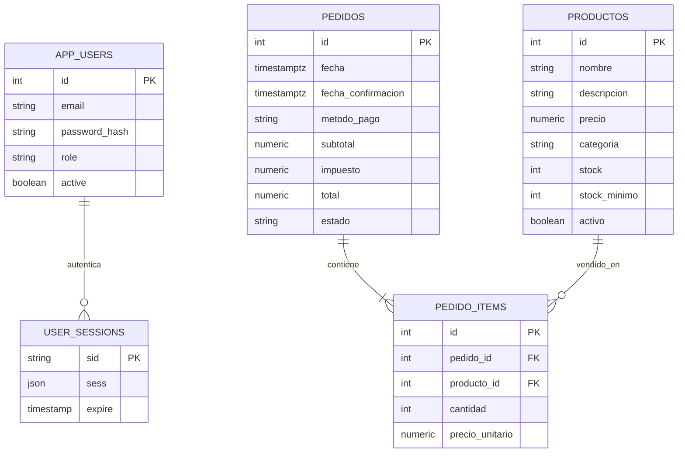

# Arquitectura — Raíz & Madera

## Modelo de datos

`productos` contiene el inventario unitario: cada unidad corresponde a una planta, pieza de mobiliario u objeto decorativo. Las categorías permitidas son `plantas`, `muebles` y `decoracion`. `pedido_items` conserva el precio histórico para que cambiar el precio del catálogo no altere ventas anteriores.

## Capas backend

- `routes/`: define HTTP methods, sesión, rol y esquema Zod.
- `controllers/`: conecta entrada/salida HTTP con los servicios.
- `services/`: validaciones de negocio, consultas parametrizadas y transacciones.
- `db.js`: pool mysql2/promise.
- `middleware/`: autentica, autoriza, valida entrada y normaliza errores.

## Reglas de stock

1. Crear una venta genera el estado `pendiente`, captura `precio_unitario` por línea y calcula subtotal, 13 % de impuesto y total.
2. Confirmar bloquea la venta con `FOR UPDATE`, agrupa cantidades por producto, bloquea productos por ID ascendente con `FOR UPDATE`, valida que las existencias alcancen y descuenta stock en la misma transacción.
3. Si un producto no existe, está inactivo o el stock no alcanza, la transacción se revierte; los conflictos de negocio devuelven `409`.
4. Anular un pedido pendiente no altera el stock. Anular una venta confirmada solo es posible hasta 15 minutos desde `fecha_confirmacion`; el stock de todas las líneas se repone dentro de una transacción.
5. Las ventas anuladas no cuentan en `/api/resumen` ni en el reporte semanal.

## Seguridad

La autenticación se basa en cookies de sesión server-side almacenadas en MySQL 8.4. El backend vuelve a consultar la cuenta y aplica la matriz de permisos. No se confía en las rutas ocultas del frontend. Los secretos de sesión y del workflow n8n quedan en variables de entorno; las consultas SQL son parametrizadas y el `ORDER BY` dinámico usa una lista blanca.

## Agente de reposición

React llama al endpoint protegido `POST /api/agente/sugerencia-compra`. El backend envía la solicitud al webhook privado de n8n con su token. El agente consulta `GET /api/reportes/productos-bajo-stock` y `GET /api/reportes/ventas-semana` usando otro token de lectura. La respuesta debe cumplir `{ ok, data, error }`. El agente sugiere; no crea órdenes ni modifica stock.
