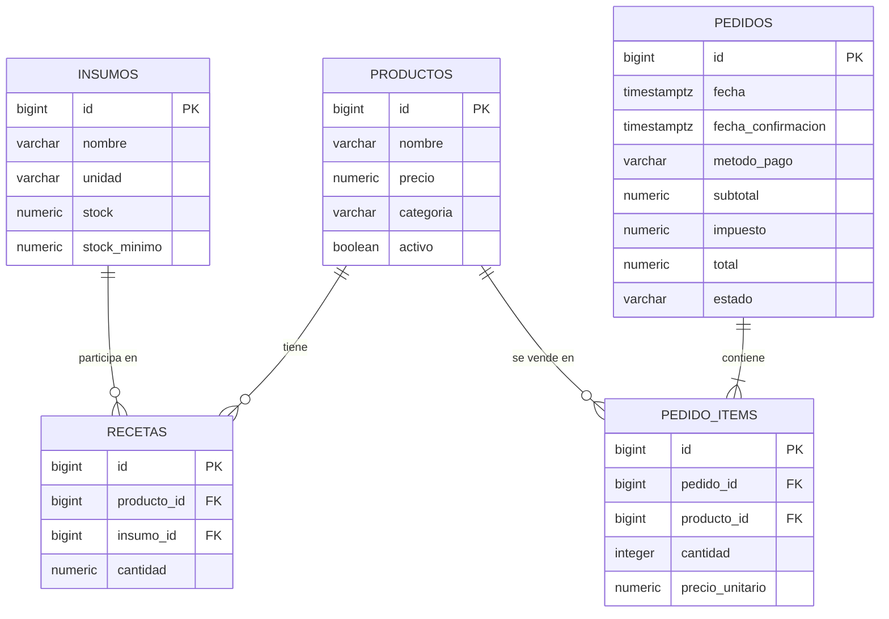

# Grano & Hoja — Fase 1: planificación del backend

## 1. Qué entendí del caso en cinco líneas

1. Grano & Hoja es una cafetería que vende productos con recetas compuestas por insumos medidos en unidades, gramos o mililitros.
2. Cada pedido guarda el precio unitario vendido para conservar el histórico aunque el precio del menú cambie después.
3. El servidor calcula el subtotal, el impuesto del 13 % y el total, y valida que el pedido completo pueda prepararse con el inventario disponible.
4. Confirmar un pedido descuenta todos los insumos requeridos dentro de una transacción; anular a tiempo revierte ese consumo.
5. El sistema ofrece un cierre diario por método de pago, los cinco productos más vendidos y un reporte semanal que permita justificar las compras sugeridas por n8n.

## 2. Diagrama entidad-relación

El siguiente diagrama refleja las cinco tablas del caso. `fecha_confirmacion` se propone como columna adicional de `pedidos` para medir correctamente los 15 minutos desde la confirmación.



### Cardinalidades

- Un producto puede usar muchos insumos, y un insumo puede formar parte de muchos productos; `recetas` resuelve esa relación muchos-a-muchos.
- Un pedido contiene una o más líneas `pedido_items`; cada línea corresponde a un producto y guarda su `precio_unitario` histórico.
- No se guarda una copia del inventario dentro de las recetas: la disponibilidad se calcula con el stock actual y las cantidades requeridas.

## 3. Contrato de endpoints propuesto

Las rutas de esta tabla son la propuesta de contrato que se implementará en la Parte 1; no se afirma que ya existan. El archivo `schema.sql` se colocará en la raíz del repositorio para que el checkpoint pueda ejecutarse con `psql -d grano_hoja -f schema.sql`. Todas las respuestas de error usarán `{ "error": "mensaje" }`. Los nombres de filtros se mantendrán estables para que React pueda consumirlos.

| Método | Ruta | Descripción | Códigos previstos |
|---|---|---|---|
| GET | `/api/insumos` | Listar insumos; filtros `q`, `bajo_minimo=true`, `ordenar_por=nombre\|stock\|stock_minimo`, `direccion=asc\|desc`. | 200, 400 |
| GET | `/api/insumos/bajo-minimo` | Insumos cuyo `stock < stock_minimo`, para el agente de compras. | 200 |
| GET | `/api/insumos/:id` | Un insumo por ID. | 200, 400, 404 |
| POST | `/api/insumos` | Crear insumo. | 201, 400, 409 |
| PUT | `/api/insumos/:id` | Reemplazar los campos editables del insumo. | 200, 400, 404, 409 |
| PATCH | `/api/insumos/:id` | Actualizar parcialmente un insumo. | 200, 400, 404, 409 |
| DELETE | `/api/insumos/:id` | Eliminar si no se utiliza en recetas; si se usa, rechazar. | 204, 400, 404, 409 |
| GET | `/api/productos` | Listar productos con `q`, `categoria`, `activo`, `ordenar_por=nombre\|precio`, `direccion=asc\|desc`; cada resultado informa `disponible` y `porciones_disponibles`. | 200, 400 |
| GET | `/api/productos/:id` | Producto con receta, insumos asociados y porciones estimadas disponibles. | 200, 400, 404 |
| POST | `/api/productos` | Crear producto y su receta en una sola operación transaccional. | 201, 400, 409 |
| PUT | `/api/productos/:id` | Reemplazar campos editables y receta del producto. | 200, 400, 404, 409 |
| PATCH | `/api/productos/:id` | Actualización parcial de campos; las recetas solo se reemplazan si se incluyen explícitamente. | 200, 400, 404, 409 |
| DELETE | `/api/productos/:id` | Eliminar el producto si no forma parte del historial de ventas. | 204, 400, 404, 409 |
| GET | `/api/pedidos` | Historial con filtros opcionales `estado`, `metodo_pago`, `desde` y `hasta`. | 200, 400 |
| GET | `/api/pedidos/:id` | Pedido con líneas, cantidades y precios históricos. | 200, 400, 404 |
| POST | `/api/pedidos` | Crear pedido pendiente con productos y cantidades; el backend toma los precios y calcula importes. | 201, 400, 404, 409 |
| POST | `/api/pedidos/:id/confirmar` | Validar todo el consumo, descontar inventario y confirmar atómicamente. | 200, 400, 404, 409 |
| POST | `/api/pedidos/:id/anular` | Anular conforme al estado y al plazo; devolver insumos si el pedido ya fue confirmado. | 200, 400, 404, 409 |
| GET | `/api/resumen?fecha=YYYY-MM-DD` | Cierre del día: total por método de pago, total general y cinco productos más vendidos. Sin `fecha`, usa el día actual de Costa Rica. | 200, 400 |
| GET | `/api/reportes/ventas-semana` | Ventas de los últimos siete días y consumo estimado de insumos según recetas para el agente. | 200 |

**Nota de enrutamiento:** registrar `GET /api/insumos/bajo-minimo` antes de `GET /api/insumos/:id` para que la palabra `bajo-minimo` no sea tratada como un ID.

### Contrato general de respuestas

- Listas: `200` con una colección JSON. El nombre exacto de la propiedad contenedora se mantendrá documentado al implementar cada ruta.
- Creación: `201` con el recurso creado.
- Errores: `{ "error": "mensaje legible" }`; el middleware central preservará `status`.
- Eliminaciones exitosas: `204 No Content`.
- `400`: parámetros o campos inválidos.
- `404`: recurso no existente.
- `409`: conflicto de negocio o integridad, como inventario insuficiente, estado incompatible, plazo de anulación vencido o eliminar un recurso relacionado.

### Ordenamiento seguro

Los valores de `ordenar_por` y `direccion` se validarán con una lista blanca. Los valores del usuario se pasan como parámetros SQL; nombres de columna y dirección no se concatenan sin validar.

## 4. Reglas de negocio y dónde se validan

1. **Importes e impuesto:** en `services/pedidos.service.js`. El backend calcula subtotal, impuesto del 13 % y total; redondea subtotal a dos decimales, calcula `ROUND(subtotal * 0.13, 2)` y suma para el total. Un importe o una cantidad inválidos produce `400`.
2. **Precio histórico:** al crear el pedido, guardar el precio vigente del producto en `pedido_items.precio_unitario`. El cliente no decide el precio final. Un producto inexistente/inactivo o datos incompatibles se rechazan con `400`, `404` o `409` según el caso.
3. **Disponibilidad del producto:** consulta SQL a partir de sus recetas y stock actual. `porciones_disponibles` es el mínimo de `FLOOR(stock / cantidad_requerida)` entre los insumos de la receta. Sin receta completa, el producto no se considera disponible.
4. **Disponibilidad del pedido completo:** `pedidos.service.js` agrupa las necesidades de todas las líneas por `insumo_id` antes de comparar con stock. Si no alcanza algún insumo, responde `409`; no evalúa cada línea de forma aislada.
5. **Confirmación atómica:** iniciar `BEGIN`, calcular necesidades agrupadas, bloquear filas de `insumos` en orden ascendente de `id` con `SELECT ... FOR UPDATE`, volver a comprobar el stock bloqueado, descontar, actualizar estado y `fecha_confirmacion`, y terminar con `COMMIT`. En cualquier excepción, `ROLLBACK` en `catch` y `release()` en `finally`.
6. **Evitar condiciones de carrera y bloqueos mutuos:** los pedidos concurrentes bloquean las filas de insumos en el mismo orden por ID. Después de obtener los bloqueos, cada transacción verifica nuevamente el stock actual antes de descontar.
7. **Anulación:** en `pedidos.service.js`, solo se anula un pedido confirmado dentro de los primeros 15 minutos desde `fecha_confirmacion`. La devolución de cantidades de todas las recetas y el cambio de estado a `anulado` ocurren en una transacción. Fuera del plazo, estado incorrecto o segunda anulación: `409`.
8. **Cierre de caja:** `GET /api/resumen`, calculado en SQL con `SUM`, `COUNT` y `GROUP BY`, usando únicamente pedidos cuyo estado final sea `confirmado`; los anulados quedan excluidos. Un formato de fecha inválido devuelve `400`.
9. **Reporte de apoyo al agente:** `GET /api/insumos/bajo-minimo` calcula el stock contra el mínimo; `GET /api/reportes/ventas-semana` agrega unidades vendidas por producto y consumo estimado por insumo a partir de receta × unidades vendidas. Solo considera ventas confirmadas no anuladas.
10. **Integridad de datos:** restricciones de PostgreSQL para campos requeridos, valores positivos, stock no negativo, estados y métodos de pago permitidos. El servicio traduce violaciones conocidas de integridad a `409`; entradas inválidas se responden como `400`.
11. **CRUD seguro:** el CRUD completo se ofrece para `insumos` y `productos`. Borrar un insumo utilizado en una receta o un producto que aparezca en el historial se rechaza con `409`; un pedido no tiene endpoint DELETE porque se conserva como historial y se anula mediante su transición de estado.

## 5. Decisiones de diseño

### Estados y transiciones del pedido

Estados: `pendiente`, `confirmado`, `anulado`. Se permite `pendiente → confirmado`; un pedido confirmado puede pasar a `anulado` una sola vez y solo durante los 15 minutos siguientes a la confirmación. Para evitar pedidos pendientes que queden abandonados, se permite `pendiente → anulado` en cualquier momento porque no ha consumido stock; en ese caso no se devuelve inventario. `anulado` es terminal. No se puede confirmar dos veces ni reactivar un pedido anulado.

### Columna de confirmación

Se añade `fecha_confirmacion TIMESTAMPTZ`: es la referencia persistida e inequívoca para aplicar el plazo de 15 minutos incluso si el servidor se reinicia.

### Cantidades y dinero

- `stock`, `stock_minimo` y `recetas.cantidad`: `NUMERIC(12,3)` para gramos, mililitros y fracciones de unidad.
- `productos.precio`, subtotal, impuesto, total y `pedido_items.precio_unitario`: `NUMERIC(12,2)`.
- `pedido_items.cantidad`: `INTEGER CHECK (cantidad > 0)` porque representa unidades vendidas de producto.
- Stock y cantidad de receta nunca pueden ser negativos; la cantidad de receta debe ser mayor que cero.

### Redondeo

El backend redondea cada campo monetario a dos decimales con aritmética decimal en PostgreSQL, no usando cálculos flotantes del navegador como fuente oficial. El impuesto se calcula sobre el subtotal redondeado y se redondea a dos decimales.

### Zona horaria

Se guardan instantes como `TIMESTAMPTZ`; las fechas de reporte se interpretan en `America/Costa_Rica`. El plazo de 15 minutos es tiempo transcurrido real entre instantes. Para el cierre diario, SQL determina el inicio y fin del día local y los convierte a límites de tiempo.

### CRUD

Los dos recursos con CRUD completo son `insumos` y `productos`; el producto se crea/edita junto con su receta en una transacción. Los pedidos se crean, consultan, confirman y anulan, pero no se borran para no destruir trazabilidad.

### Claves foráneas y restricciones previstas

- `recetas.producto_id → productos.id ON DELETE CASCADE`: la receta depende del producto y no existe de forma independiente.
- `recetas.insumo_id → insumos.id ON DELETE RESTRICT`: no se permite borrar un insumo requerido por una receta.
- `pedido_items.pedido_id → pedidos.id ON DELETE RESTRICT`: evita borrar pedidos con historial de líneas.
- `pedido_items.producto_id → productos.id ON DELETE RESTRICT`: protege el historial de ventas del producto.
- `UNIQUE(recetas.producto_id, recetas.insumo_id)`: una receta contiene una sola línea por insumo; se suman cantidades antes de guardar.
- `CHECK(stock >= 0)` y `CHECK(stock_minimo >= 0)`: impiden inventario negativo o mínimos absurdos.
- `CHECK(precio > 0)` y `CHECK(cantidad > 0)`: impiden vender con precios/cantidades no válidos.
- `CHECK(metodo_pago IN ('efectivo','tarjeta','sinpe_movil'))` y `CHECK(estado IN ('pendiente','confirmado','anulado'))`: limitan valores a estados y métodos conocidos.
- Las filas de `pedido_items` son históricas; `precio_unitario` es una instantánea del precio al crear el pedido.

## 6. Árbol de carpetas del backend

```text
Grano-Hoja/
├── schema.sql                  # Se ejecuta desde la raíz en la Fase 2
└── backend/
    ├── .env.example
    ├── .gitignore
    ├── package.json
    └── src/
        ├── app.js
        ├── server.js
        ├── db.js
        ├── routes/
        │   ├── insumos.routes.js
        │   ├── productos.routes.js
        │   ├── pedidos.routes.js
        │   ├── resumen.routes.js
        │   └── reportes.routes.js
        ├── controllers/
        │   ├── insumos.controller.js
        │   ├── productos.controller.js
        │   ├── pedidos.controller.js
        │   ├── resumen.controller.js
        │   └── reportes.controller.js
        ├── services/
        │   ├── insumos.service.js
        │   ├── productos.service.js
        │   ├── pedidos.service.js
        │   ├── resumen.service.js
        │   └── reportes.service.js
        ├── middlewares/
        │   ├── not-found.js
        │   └── error-handler.js
        └── utils/
            └── AppError.js
```

## 7. Prueba de conectividad cuando se implemente la API

Con el servidor iniciado y el puerto real confirmado, consultar el resumen:

```bash
curl -i "http://localhost:PUERTO/api/resumen"
```

Comprobar las cabeceras CORS para el origen de Vite:

```bash
curl -i -H "Origin: http://localhost:5173" "http://localhost:PUERTO/api/resumen"
```

Para el preflight de una petición JSON:

```bash
curl -i -X OPTIONS "http://localhost:PUERTO/api/productos" \
  -H "Origin: http://localhost:5173" \
  -H "Access-Control-Request-Method: POST" \
  -H "Access-Control-Request-Headers: content-type"
```

`curl` muestra cabeceras pero no aplica la política CORS del navegador; la confirmación final se hace en DevTools → Network/Console. Se reemplazará `PUERTO` por el valor real de `PORT` al crear `.env.example`.

## 8. Fuera de alcance

Los combos con 10 % de descuento no se implementan. Si luego se solicitan, conviene modelarlos como una entidad de combo con sus componentes y aplicar el descuento en el servicio de pedidos, conservando un registro claro del importe descontado.
